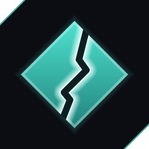
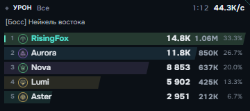
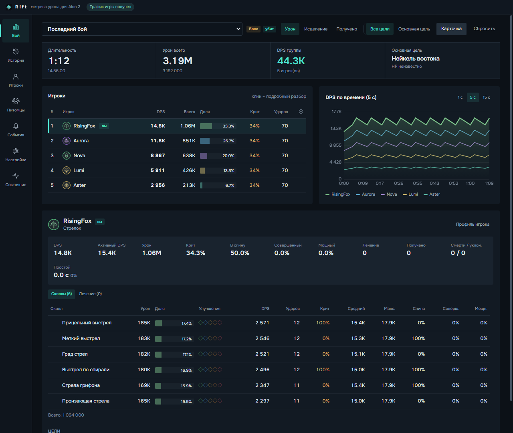
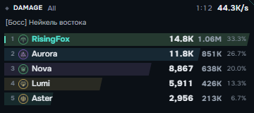
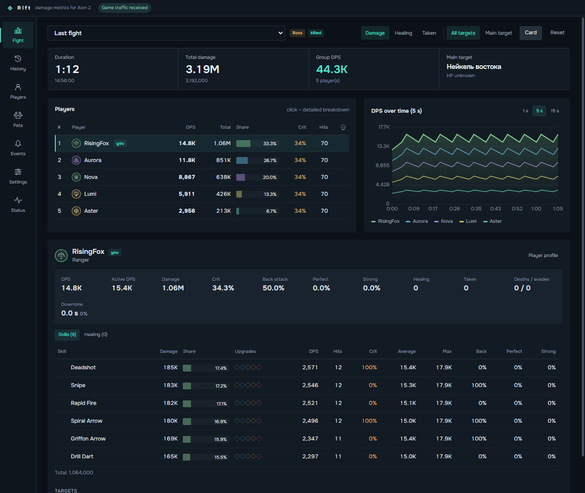

# Rift

### Damage meter for Aion 2

Компактная метрика в игре. Подробности – когда они нужны.

A compact meter in game. The details when you need them.

**Windows x64 · RU / EN · Global · Pre-release**

[**Скачать / Download**](https://github.com/RisingFox/Rift_DPSTracker/releases) · [Сообщить о проблеме / Report an issue](https://github.com/RisingFox/Rift_DPSTracker/issues)

[Русский](#ru) · [English](#en)

---

## Русский

Rift – бесплатный трекер урона для глобальной версии Aion 2. Маленькое окно показывает бой поверх игры, а большое помогает разобраться в результатах, посмотреть историю и открыть профиль игрока.

> **Сейчас идёт тестирование.** Возможны ошибки распознавания, расчётов и отображения. После обновлений игры совместимость может потребовать исправлений.

### Как это выглядит

**Компактная метрика**

**Большое окно с разбором боя**

*Снимки настоящего интерфейса на демонстрационных данных. Ники и результаты вымышленные; метрика показана на нейтральном фоне.*

### Скачать и начать

1. Откройте [список релизов](https://github.com/RisingFox/Rift_DPSTracker/releases) и выберите нужный выпуск. Тестовые версии отмечены **Pre-release**.
2. В разделе **Assets** скачайте `Rift-Setup-<версия>-x64.exe`. Файлы `.blockmap` и `latest.yml` вручную скачивать не нужно.
3. Запустите установщик: выберите язык, прочитайте соглашение, укажите папку и необходимость ярлыка. Проверьте параметры и нажмите **«Установить»**.
4. Если Npcap отсутствует, Rift предложит установить его. Завершите установку драйвера по подсказкам приложения.
5. Запустите Rift и войдите на персонажа. Если игра уже открыта, перезайдите на персонажа, чтобы трекер получил свежие данные.

**Требования:** 64-разрядная Windows, установленная игра и [Npcap](https://npcap.com/#download). Node.js и .NET отдельно устанавливать не нужно. Для оверлея используйте оконный режим игры или полноэкранный режим без рамки.

### Что умеет Rift

| Возможность | Для чего |
| :--- | :--- |
| Компактная метрика | Урон, исцеление и полученный урон поверх игры; размер, прозрачность и состав колонок настраиваются |
| Разбор боя | Игроки, навыки, цели, критические попадания, доля урона и график DPS |
| История и рекорды | Просмотр завершённых боёв и личных результатов по боссам |
| Профили игроков | Экипировка и доска Даэваниона по данным официального сайта NC |
| Коллекция питомцев | Прогресс коллекции в большом окне и отдельный компактный список для ближайших мобов |
| События | Расписание, напоминания и настройка часового пояса |
| Два языка | Русский и английский интерфейс |

Большое окно открывается через значок Rift в области уведомлений Windows. Коллекция питомцев включается отдельно; для начального определения прогресса нужен свежий вход на персонажа.

### Управление

Горячие клавиши по умолчанию; их можно изменить в настройках.

| Клавиши | Действие |
| :--- | :--- |
| `Ctrl + Alt + D` | Показать или скрыть метрику |
| `Ctrl + Alt + L` | Включить или отключить клики сквозь окно |
| `Ctrl + Alt + R` | Завершить текущий замер и сбросить метрику |
| `Ctrl + Alt + M` | Переключить урон, исцеление и полученный урон |

### Как работают обновления

Rift проверяет новые версии при запуске и затем раз в шесть часов. Доступное обновление скачивается в фоне. Когда оно готово, в большом окне появляется кнопка **«Установить и перезапустить»**. После подтверждения приложение обновляется без повторного прохождения мастера установки.

Rift сам не перезапускается во время боя. Настройки, история и коллекция сохраняются. Проверить наличие обновлений или повторить неудавшуюся загрузку можно в разделе **«Состояние»**.

> **Тестовые выпуски:** текущий механизм автообновлений получает только стабильные релизы. Версии с меткой **Pre-release** устанавливаются вручную из [списка релизов](https://github.com/RisingFox/Rift_DPSTracker/releases). Сборки до 0.1.4 также требуют ручной установки новой версии: в них ещё не был настроен адрес обновлений.

### Как Rift получает данные

Модуль захвата пассивно читает входящий игровой трафик через Npcap. Он не читает и не изменяет память игры, не внедряет код, не отправляет и не изменяет игровые пакеты.

Настройки, история, коллекция и записи сессий хранятся на вашем компьютере. Rift не отправляет эти файлы разработчику. Для профилей игроков, изображений, обновлений и загрузки Npcap используются запросы к внешним сервисам.

### Вопросы и помощь

<strong>Не появляется урон или не определяется персонаж</strong>

Откройте **«Состояние»** и проверьте наличие Npcap и поступление игрового трафика. Если Rift запущен уже после входа в игру, перезайдите на персонажа. Если проблема осталась, создайте [Issue](https://github.com/RisingFox/Rift_DPSTracker/issues) с версией Rift и описанием ситуации.

<strong>Коллекция питомцев ожидает данные</strong>

Включите коллекцию на вкладке **«Питомцы»** и перезайдите на персонажа. Для достоверного прогресса Rift нужен начальный снимок коллекции из игрового трафика.

<strong>Windows показывает «Неизвестный издатель»</strong>

Текущие сборки не имеют цифровой подписи издателя. Скачивайте установщик только из [релизов этого репозитория](https://github.com/RisingFox/Rift_DPSTracker/releases). Если Windows блокирует запуск, сначала проверьте источник файла; решение о запуске остаётся за вами.

<strong>Как сообщить об ошибке</strong>

Создайте [Issue](https://github.com/RisingFox/Rift_DPSTracker/issues) и укажите версию Rift, действия перед ошибкой, ожидаемый и фактический результат. При необходимости приложите скриншот, скрыв личные данные. Записи сетевых сессий не публикуйте: они могут содержать ники и другие данные игроков.

<strong>Как удалить Rift и что будет с данными</strong>

Откройте **Параметры Windows → Приложения → Rift → Удалить**. Настройки, история, коллекция и записи останутся в `%APPDATA%\aion2-dps-tracker`. Если они больше не нужны, удалите эту папку вручную после закрытия Rift. Npcap удаляется отдельно через список приложений Windows.

[Наверх ↑](#rift) · [English ↓](#en)

---

## English

Rift is a free damage meter for the global version of Aion 2. A small overlay keeps the fight in view, while the main window lets you explore results, browse fight history and open player profiles.

> **Currently in testing.** Recognition, calculations and display may contain errors. Game updates may require compatibility fixes.

### A look inside

**Compact meter**

**Main window and fight breakdown**

*Screenshots of the actual interface using demonstration data. Player names and results are fictional; the meter is shown against a neutral background.*

### Download and get started

1. Open the [release list](https://github.com/RisingFox/Rift_DPSTracker/releases) and choose a version. Test builds are marked **Pre-release**.
2. Under **Assets**, download `Rift-Setup-<version>-x64.exe`. You do not need to download `.blockmap` or `latest.yml` manually.
3. Run the installer: choose a language, read the agreement, select the application folder and decide whether to create a desktop shortcut. Review your choices and click **Install**.
4. If Npcap is missing, Rift will offer to install it. Follow the application's instructions to complete the driver installation.
5. Start Rift and log in to your character. If the game is already running, log out of your character and back in so the tracker receives fresh data.

**Requirements:** 64-bit Windows, the game and [Npcap](https://npcap.com/#download). No separate Node.js or .NET installation is needed. Use windowed or borderless fullscreen mode for the overlay.

### What Rift offers

| Feature | What it does |
| :--- | :--- |
| Compact meter | Damage, healing and damage taken over the game, with adjustable size, opacity and columns |
| Fight breakdown | Players, skills, targets, critical hits, damage share and a DPS chart |
| History and records | Completed fights and personal boss records |
| Player profiles | Equipment and Daevanion boards using data from the official NC website |
| Pet collection | Collection progress in the main window and a separate compact list for nearby monsters |
| Events | Schedule, reminders and time zone settings |
| Two languages | Russian and English interface |

Open the main window through the Rift icon in the Windows notification area. Pet tracking is optional; log in to your character after enabling it to receive the initial collection data.

### Controls

Default hotkeys; you can change them in Settings.

| Keys | Action |
| :--- | :--- |
| `Ctrl + Alt + D` | Show or hide the meter |
| `Ctrl + Alt + L` | Toggle click-through mode |
| `Ctrl + Alt + R` | End the current measurement and reset the meter |
| `Ctrl + Alt + M` | Switch between damage, healing and damage taken |

### How updates work

Rift checks for updates at startup and every six hours. Available updates download in the background. When ready, an **Install and restart** button appears in the main window. After confirmation, Rift updates without repeating the setup wizard.

Rift does not restart automatically during a fight. Settings, history and collection progress are preserved. You can check for updates or retry a failed download from **Status**.

> **Test builds:** the current updater receives stable releases only. Builds marked **Pre-release** must be installed manually from the [release list](https://github.com/RisingFox/Rift_DPSTracker/releases). Versions before 0.1.4 also need a manual upgrade because their update source had not yet been configured.

### How Rift gets its data

The capture module passively reads incoming game traffic through Npcap. It does not read or modify game memory, inject code, send game packets or modify them.

Settings, history, collection progress and session recordings stay on your computer. Rift does not upload these files to the developer. Player profiles, images, updates and Npcap downloads require requests to external services.

### Questions and help

<strong>No damage appears or my character is not detected</strong>

Open **Status** and check whether Npcap is installed and game traffic is being received. If you started Rift after logging in, log out of your character and back in. If the issue persists, [open an issue](https://github.com/RisingFox/Rift_DPSTracker/issues) with your Rift version and a description of the problem.

<strong>The pet collection is waiting for data</strong>

Enable collection tracking in **Pets**, then log out of your character and back in. Rift needs an initial collection snapshot from game traffic to track progress reliably.

<strong>Windows shows “Unknown publisher”</strong>

Current builds do not have a publisher's digital signature. Download the installer only from [this repository's releases](https://github.com/RisingFox/Rift_DPSTracker/releases). If Windows blocks the file, check its source first; the decision to run it is yours.

<strong>How to report a bug</strong>

[Open an issue](https://github.com/RisingFox/Rift_DPSTracker/issues) with your Rift version, the steps leading to the problem, and the expected and actual results. Add a screenshot if helpful, hiding personal information. Do not post network session recordings publicly: they may contain player names and other player data.

<strong>How to uninstall Rift and what happens to my data</strong>

Open **Windows Settings → Apps → Rift → Uninstall**. Settings, history, collection progress and recordings remain in `%APPDATA%\aion2-dps-tracker`. If you no longer need them, delete that folder manually after closing Rift. Uninstall Npcap separately through the Windows app list.

[Back to top ↑](#rift) · [Русский ↑](#ru)

---

**RisingFox · Rift**

Rift – независимый проект, не связанный с NCSOFT Corporation и не одобренный ею. Названия и игровые материалы принадлежат соответствующим правообладателям. Условия использования и уведомления о сторонних компонентах входят в установку: `LICENSE.txt` и `THIRD-PARTY-NOTICES.txt`.

Rift is an independent project, not affiliated with or endorsed by NCSOFT Corporation. Game names and materials belong to their respective rights holders. Terms of use and third-party notices are included with the installation: `LICENSE.txt` and `THIRD-PARTY-NOTICES.txt`.
